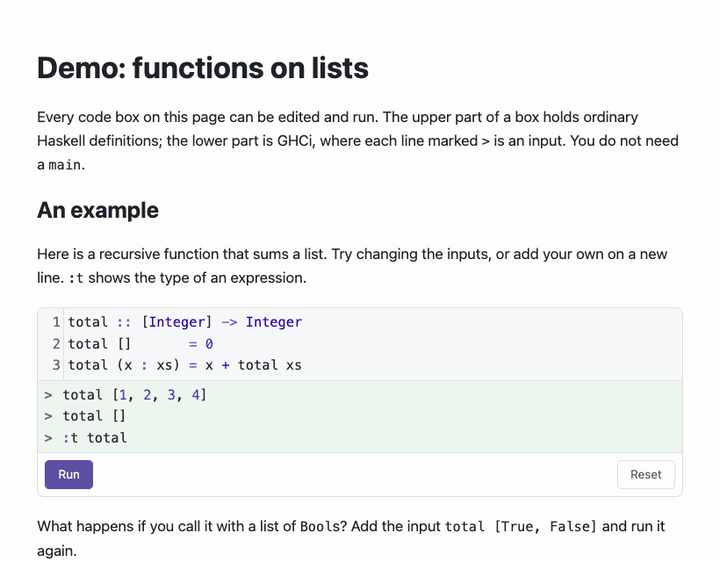

# Thunk: runnable Haskell in web pages

Thunk turns Haskell code blocks in a Markdown page into boxes readers can
edit and run: examples with a GHCi-like panel, exercises checked with
QuickCheck, hints, and optional AI help. The code runs on a server
(play-haskell with a GHCi mode), so the page itself is plain HTML.



*(The wait for the hint is shortened in the recording; on a free model
tier it can take half a minute.)*

Written for the Haskell course TDA452/DIT143 at Chalmers, where it
serves interactive versions of the lectures.

*Work in progress, not yet released. The design decisions are in
[docs/DESIGN-NOTES.md](docs/DESIGN-NOTES.md).*

## Writing pages

````markdown
```haskell {.exercise}
count :: Char -> String -> Int
count c s = undefined

>>> count 'a' "banana"
```

```haskell {.check}
prop> \c s -> count c s == length (filter (== c) s)
```
````

The reader gets an editor with Run and Check. The full format is in
[docs/WRITING.md](docs/WRITING.md).

## Parts

- `widget/`: the pandoc filters (`names.lua`, `filter.lua`), page
  template, `notes.js`, and the stylesheets `thunk.css` (the blocks) and
  `page.css` (a standalone page). `widget/build.sh page.md out/` builds a
  page;
  `widget/build-canvas.sh` builds one small page per block, for an LMS
  that accepts iframes (such as Canvas).
- `server/`: Thunk, the server that runs the code: play-haskell
  (submodule) with our patches (`server/patches/`), in Docker.
- `hints/`: an optional service that asks an AI model for a hint when a
  Check fails, and counts button presses (no code, no identities).
- `deploy/`: Thunk, the hint service and Caddy (https, origin check,
  rate limit) for a public server.
- `demo/`, `tests/`: demo pages, and a browser test that runs every
  page's examples and checks every exercise's solution
  (`PAGE_DIRS="my/pages" node tests/visual.mjs` for your own pages).
- `tools/convert-names.py`: brings pages written with older names up to
  date; `tools/record-demo.mjs` records `docs/demo.gif`;
  `tools/record-replay.mjs` records a page's results for replay mode.

## Running locally

Needs Docker, pandoc, and (for the tests) Node and Google Chrome or
Chromium (`CHROME=/path/to/chrome` if it is not found).

```bash
git submodule update --init
(cd server && docker compose up -d)        # Thunk on localhost:8123
widget/build.sh demo/demo.md _site
(cd _site && python3 -m http.server 8000 --bind 127.0.0.1)
node tests/visual.mjs                      # must end "all checks passed"
node tests/replay.mjs                      # the demo with no server
```

A page can also be published with its results recorded and no server
(replay mode: readers can run the page's own code, and changed code
says it needs a server); see section 9 of
[docs/WRITING.md](docs/WRITING.md).

## Related tools

- **Literate Haskell** (`.lhs`, `markdown-unlit`): the document is one
  program that GHC compiles. A Thunk page is not one program (boxes
  redefine names, exercises contain `undefined`), so it is not an
  `.lhs` file, but it uses the same idea of marking code blocks with a
  class.
- **doctest**: Thunk uses its conventions: `>>>` for GHCi inputs,
  `prop>` for properties, and its layout of input and expected output
  for the tests written in a page.
- **Run when the page is built**: Quarto with IHaskell, Hakyll and
  similar generators run the code once; readers see fixed output.
- **Run by the reader**: Thebe (Jupyter Book's live code, with a
  Jupyter kernel), Klipse (several languages in the browser) and
  CodeWorld (Haskell, as a platform of its own). Thunk is of this kind:
  reader-run Haskell in any page, without Jupyter, with exercises and
  tests built in.

## Licence

MIT (see [LICENSE](LICENSE)). The server builds on
[play-haskell](https://github.com/tomsmeding/play-haskell) by Tom Smeding,
also MIT-licensed.
